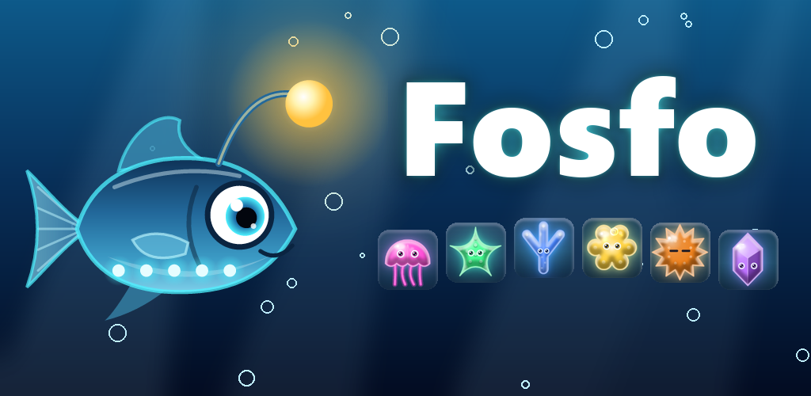

# Fosfo: Luci degli Abissi

**Accendi il buio degli abissi: un puzzle match-3 con creature luminose e un faro.**

Scendi con Fosfo, un piccolo pesce lanterna, nel fondale più buio dell'oceano. Laggiù il Faro Sommerso si è spento
e solo la tua luce può riaccenderlo. Unisci tre o più creature luminose dello stesso colore: ogni combinazione accende
le caselle buie sotto di loro. Quando tutto il fondale brilla, il livello è vinto.

- Ghiaccio nero, inchiostro dei polpi e correnti marine
- Cinque zone da esplorare e una storia con Fosfo e Nautilo, il guardiano del faro
- Il Bestiario degli Abissi, il Reef di Fosfo e il guardaroba
- Sfida del giorno, obiettivi, classifiche e salvataggio sul cloud con Google Play Games

Disponibile per Android su Google Play (in italiano, inglese, francese, spagnolo e tedesco).

---

## Fosfo: Abyss Lights

**Light up the dark ocean floor in a match-3 puzzle with glowing sea creatures.**

Dive with Fosfo, a little lanternfish, to the darkest depths of the ocean. The Sunken Lighthouse has gone dark,
and only your light can bring it back. Match three or more glowing creatures of the same color to light up
the dark tiles beneath them: when the whole seabed shines, you win the level.

Available for Android on Google Play (English, Italian, French, Spanish and German).

---

**Informativa sulla privacy / Privacy policy:** [sites.google.com/view/fosfo-privacy](https://sites.google.com/view/fosfo-privacy)

**Contatti / Contact:** [sportelligionni@gmail.com](mailto:sportelligionni@gmail.com)

© 2026 Gionni Sportelli
