[← Fosfo: Luci degli Abissi](../)

# Press kit

**Tutto in un file / Everything in one file:** [fosfo_press_kit.zip](fosfo_press_kit.zip) (logo, icona, grafica, screenshot in
italiano e inglese, GIF, testi / logo, icon, artwork, Italian and English screenshots, GIFs, texts).

Le immagini e le GIF si possono usare liberamente per articoli, recensioni e video su Fosfo.
Images and GIFs may be freely used in articles, reviews and videos about Fosfo.

## Scheda / Fact sheet

| | |
|---|---|
| Titolo / Title | Fosfo: Luci degli Abissi · Fosfo: Abyss Lights |
| Genere / Genre | puzzle match-3 |
| Piattaforma / Platform | Android ([Google Play](https://play.google.com/store/apps/details?id=com.gionnisportelli.fosfo&referrer=utm_source%3Dsito%26utm_campaign%3Dpresskit)) |
| Uscita / Release | 18/11/2026 |
| Prezzo / Price | gratis / free |
| Lingue / Languages | italiano, English, français, español, Deutsch |
| Sviluppatore / Developer | Gionni Sportelli, sviluppatore indipendente / independent developer (Italia / Italy) |
| Trailer | [youtube.com/watch?v=JS0RzNWodeQ](https://www.youtube.com/watch?v=JS0RzNWodeQ) |
| Contatti / Contact | [sportelligionni.dev@gmail.com](mailto:sportelligionni.dev@gmail.com) |

## In movimento / In motion

<a href="fosfo_sfere.gif">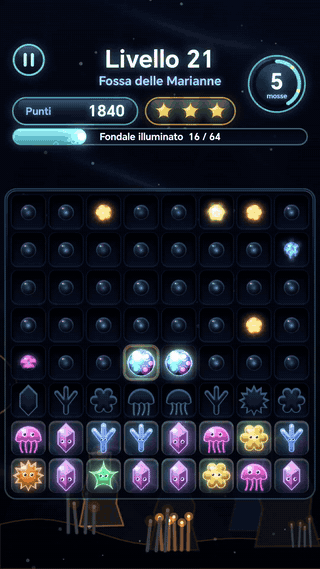</a>
<a href="fosfo_ultima_mossa.gif">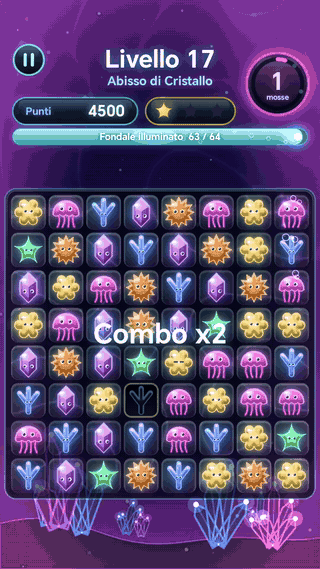</a>
<a href="fosfo_bestiario.gif">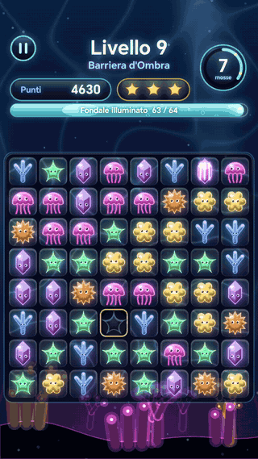</a>

## Immagini / Images

<a href="fosfo_grafica_1024x500.png">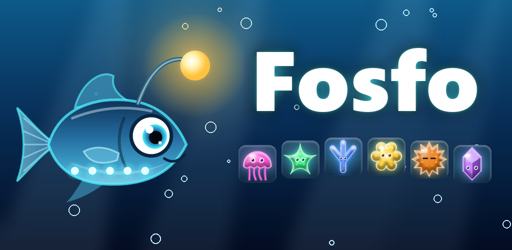</a>
<a href="fosfo_icona_512.png">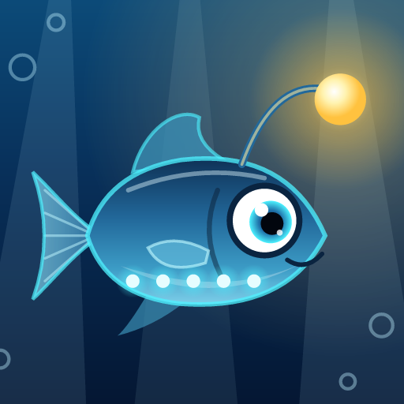</a>

- [Logo (PNG trasparente / transparent)](fosfo_logo.png)
- [Icona / Icon 512×512](fosfo_icona_512.png)
- [Fosfo, il personaggio / the character 800×800](fosfo_personaggio_800x800.png)
- [Grafica / Artwork 1024×500](fosfo_grafica_1024x500.png)
- [Banner 2560×1440](fosfo_banner_2560x1440.png)

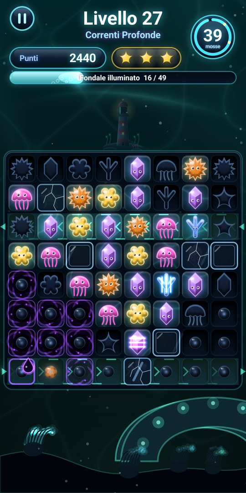
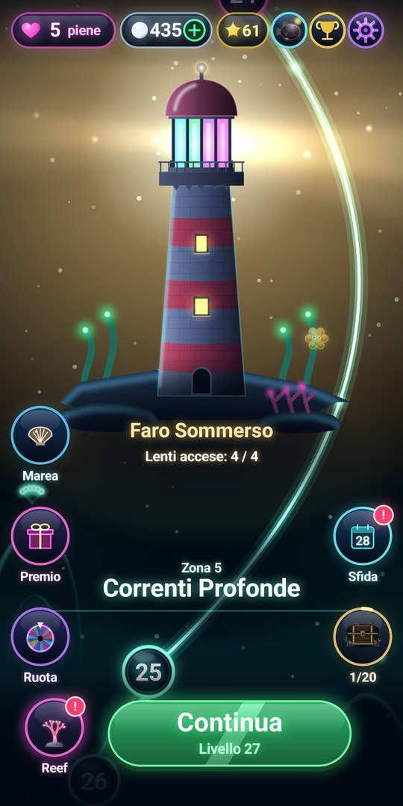
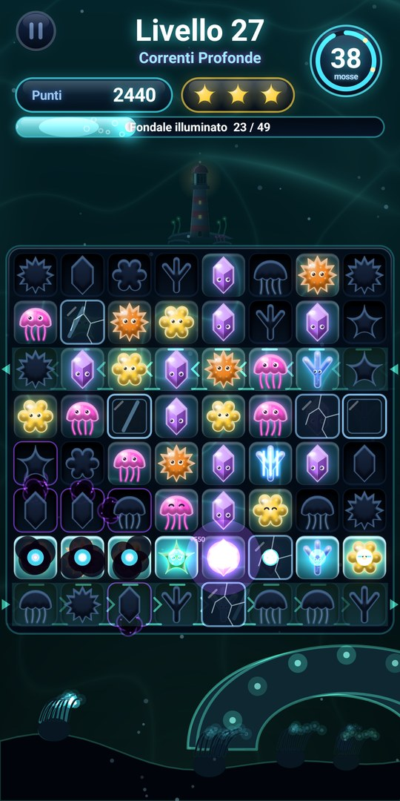
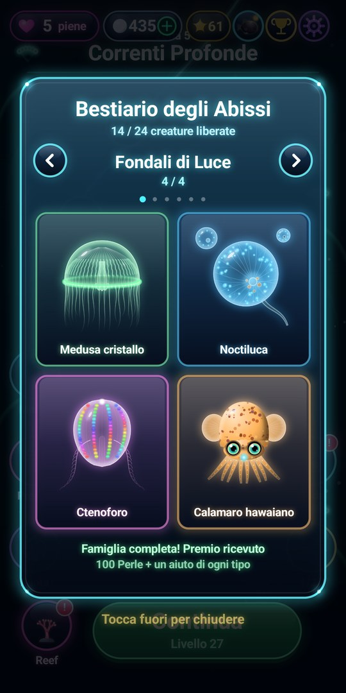
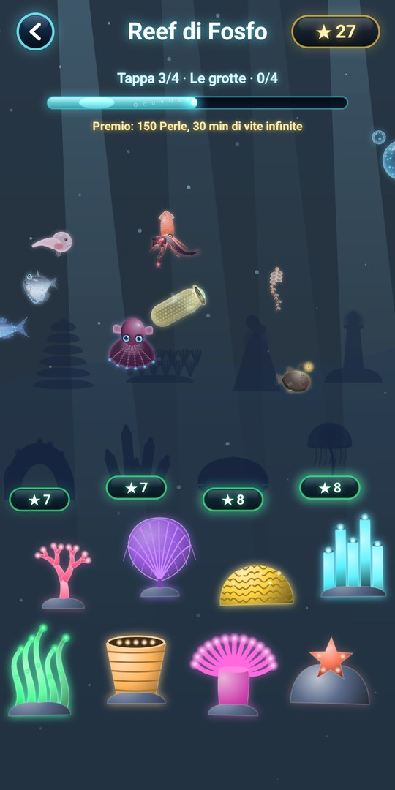
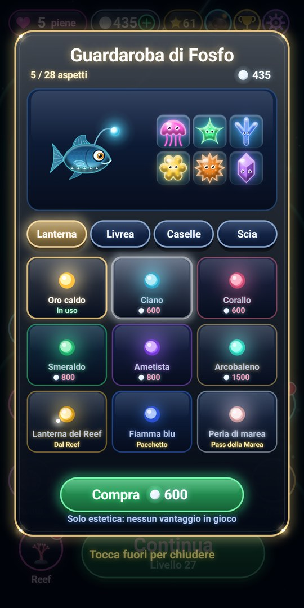

Screenshot a piena risoluzione (1080×2160) in italiano e inglese nello ZIP. / Full-resolution screenshots (1080×2160) in
Italian and English in the ZIP.

---

## Italiano

**In una riga.** Accendi il buio degli abissi: un puzzle match-3 con creature luminose e un faro sommerso da riaccendere.

**Testo breve.** Fosfo è un puzzle match-3 ambientato sul fondale più buio dell'oceano. Ogni combinazione di creature
luminose accende le caselle buie: quando tutto il fondale brilla, il livello è vinto. Nel buio i colori sono nascosti, e
bisogna leggere sagome e lucine per trovare la mossa giusta.

**Testo lungo.**

Scendi con Fosfo, un piccolo pesce lanterna, fino al fondale dell'oceano: laggiù il Faro Sommerso si è spento e solo la tua
luce può riaccenderlo.

La regola è semplice: unisci tre o più creature dello stesso colore e le caselle sotto di loro si accendono. La novità è il
buio: nelle caselle spente i colori non si vedono. Si intuiscono dalle sagome nella penombra e dalle lucine che le creature
accendono per un attimo, e ogni mossa diventa un piccolo enigma.

Cinque zone, dai Fondali di Luce alle Correnti Profonde, portano ostacoli nuovi: ghiaccio nero, inchiostro dei polpi che si
allarga, correnti che spostano le righe. Ogni zona finita riaccende una lente del faro, in una storia con Fosfo e Nautilo, il
vecchio guardiano.

Nel buio si nascondono anche creature vere degli abissi, come il sifonoforo o la rana pescatrice: liberandole si raccolgono
nel Bestiario, ognuna con una curiosità scientifica. Ci sono poi una sfida del giorno uguale per tutti, il Reef da ricostruire
con le stelle, obiettivi e classifiche di Google Play Games.

Fosfo è fatto da una sola persona, in Italia: grafica, effetti sonori e brusio dell'oceano sono creati nel codice del gioco.

## English

**One liner.** Light up the dark ocean floor in a match-3 puzzle with glowing sea creatures and a sunken lighthouse to relight.

**Short description.** Fosfo is a match-3 puzzle set on the darkest ocean floor. Every match of glowing creatures lights up
the dark tiles beneath them: when the whole seabed shines, you win the level. In the dark the colors are hidden, so you read
shapes and fleeting lights to find the right move.

**Long description.**

Dive with Fosfo, a little lanternfish, to the bottom of the ocean: the Sunken Lighthouse has gone dark, and only your light
can bring it back.

The rule is simple: match three or more creatures of the same color and the tiles beneath them light up. The twist is the
dark: on unlit tiles the colors are hidden. You guess them from shapes in the twilight and from the lights the creatures flash
for a moment, so every move becomes a small puzzle.

Five zones, from the Shallows of Light to the Deep Currents, bring new obstacles: black ice, spreading octopus ink, currents
that shift whole rows. Every zone you clear relights a lens of the lighthouse, in a story with Fosfo and Nautilo, the old
lighthouse keeper.

Real deep-sea creatures hide in the dark too, like the siphonophore or the anglerfish: free them to fill the Bestiary, each
with a real scientific fact. There is also a daily challenge that is the same for everyone, a Reef to rebuild with stars, and
Google Play Games achievements and leaderboards.

Fosfo is made by one person in Italy: graphics, sound effects and the ocean ambience are all generated in the game's code.

---

Google Play e il logo di Google Play sono marchi di Google LLC. / Google Play and the Google Play logo are trademarks of Google LLC.

© 2026 Gionni Sportelli
